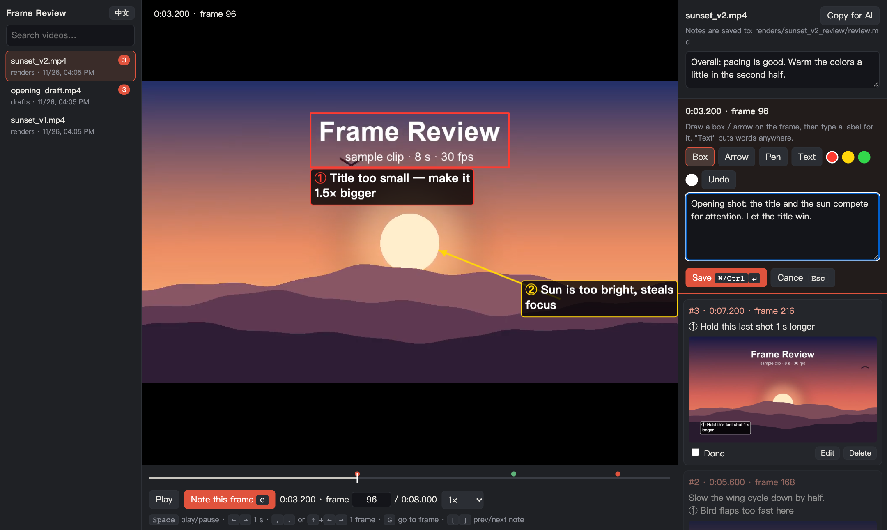
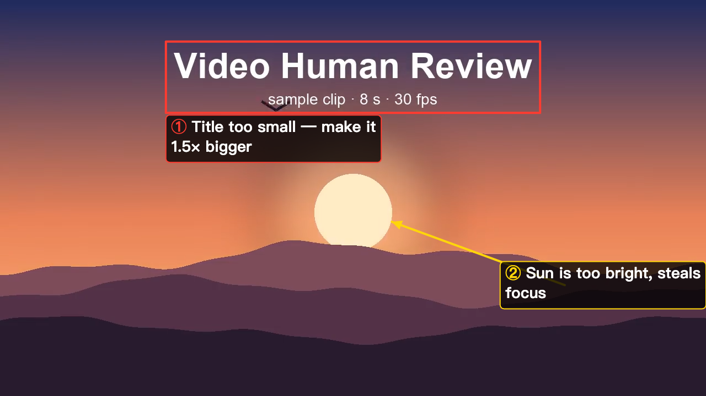

<div align="center">

# Video Human Review

**Pause any frame, draw on it, write a note — and hand the whole review to your AI assistant in one line.**

English · [中文](README.zh-CN.md)



</div>

Reviewing a video with an AI assistant usually means: pause, take a screenshot, crop it, paste it into chat, type "at 0:03 the title is too small…", repeat twenty times. **Video Human Review** turns that into: pause → draw → type → next. When you're done, it has already written a Markdown file with every note (timecode, exact frame number, where on screen, what to change) plus an annotated screenshot for each one. You paste a single sentence to Claude, ChatGPT, Codex, Cursor or any agent that can read files, and it works through the list.

It's a tiny local web app: one Python file, no dependencies, nothing uploaded anywhere.


## Features

- **Frame-accurate** — shows the exact frame number (reads the real frame rate with `ffprobe`), step frame by frame, or type a frame number to jump there.
- **Draw on the frame** — box, arrow, freehand pen and free text, in four colors. Every mark gets its own label right next to it, numbered ①②③ so the text and the picture line up.
- **AI-readable export** — `review.md` lists each note with time, frame, the mark's position in words (`box (top-middle, x 24%–76%, y 10%–28%)`) and your label, plus a path to the annotated screenshot and a clean copy of the frame.
- **Review workflow** — notes show up as dots on the timeline, newest first in the sidebar; edit, delete, tick "Done", jump between notes with `[` `]`, and keep overall notes that aren't tied to a frame.
- **Collect assets** — box the part of a good frame you want to keep (an object, a sky, a fire, a composition); it is saved as a crop plus the clean full frame for your AI to rebuild as reusable material. The AI's rebuild shows next to your crop, and you approve or reject it.
- **English / 中文** — switch the UI any time; the Markdown file is rewritten in the same language.
- **Local and private** — serves only the folder you point it at, binds to `127.0.0.1` by default, and writes notes next to each video.

## Quick start

Requires Python 3.7+ and a modern browser (Chrome, Edge, Safari, Firefox). [FFmpeg](https://ffmpeg.org/download.html) is optional but recommended so frame numbers use the video's real frame rate (otherwise 30 fps is assumed).

```bash
git clone https://github.com/abysscat-yj/video-human-review-for-ai.git
cd video-human-review-for-ai
python3 video_human_review.py demo --open        # try it on the bundled 8-second sample
```

Then point it at your own videos:

```bash
python3 video_human_review.py ~/Videos/my-project --open
```

Every video under that folder (`.mp4 .mov .m4v .webm .mkv`, subfolders included) appears in the left sidebar, newest first.

| Option | Default | |
|---|---|---|
| `VIDEO_DIR` | current folder | folder to scan for videos |
| `--port` | `8765` | also `VIDEO_REVIEW_PORT` |
| `--host` | `127.0.0.1` | use `0.0.0.0` only if you want others on your network to reach it |
| `--open` | off | open the browser after starting |

## Writing a note

1. Pause on the frame (or press `G` and type a frame number) and press **`C`**.
2. Drag a **box** or **arrow** on the video — a small input pops up next to it; type what's wrong there and press `Enter`. Use **Pen** to circle things and **Text** to put words anywhere.
3. Write the general note for this frame in the side panel and press **`⌘/Ctrl + Enter`**.

The screenshot is saved at the video's full resolution, with your marks drawn on it:



## Collecting assets

When a frame looks good, keep the good part so your AI can turn it into something reusable.

1. Pause on the frame and press **`A`** (or click **Collect asset**).
2. Drag a box around what you want to keep. Everything outside it dims, and the sidebar shows the crop.
3. Pick a category (Object, Set, Sky & light, Effect, Composition, Lettering, Figure), give it a name and say what you like about it, then press **`⌘/Ctrl + Enter`**.

Collected assets appear under the **Assets** tab and as gold ticks on the timeline. Files go into `assets/` inside the review folder:

```
opening_draft_review/
└── assets/
    ├── assets.json        ← the list; your AI reads it and writes back to it
    ├── a001_crop.png      ← the boxed part, at full resolution
    ├── a001_full.png      ← the clean full frame
    └── a001_ai.png        ← the AI's rebuild, once it has one (optional)
```

Each entry in `assets.json` records the video path, seconds, frame, fps, the box (`[x0, y0, x1, y1]` as 0–1 fractions), category, name and note, plus a status:

| Status | Set by | Meaning |
|---|---|---|
| `inbox` | the tool | just collected, waiting for the AI |
| `candidate` | the AI | rebuilt; `ai.render` names an image of the rebuild for you to check |
| `approved` | you | you clicked **Approve** |
| `rejected` | you | you clicked **Reject** and gave a reason (`verdict.text`); the AI redoes it and sets it back to `candidate` |

**Copy for AI** on the Assets tab copies a line pointing at `assets.json`. How the AI turns an asset into code or a recipe is up to your project; the tool only collects and reviews. After the AI writes back, switch back to the browser window and the list refreshes. Changing only the name, note or category keeps the AI's work; redrawing the box sends the entry back to `inbox`.

## What your AI gets

Click **Copy for AI** and paste. The message points to `review.md`, which looks like this:

```markdown
### #1 [ ] 0:03.200 (frame 96)

Opening shot: the title and the sun compete for attention. Let the title win.

On-screen annotations (numbers match the screenshot):
- ① box (top-middle, x 24%–76%, y 10%–28%): Title too small — make it 1.5× bigger
- ② arrow (pointing at center, x 56%, y 56%): Sun is too bright, steals focus

Screenshot: `renders/sunset_v2_review/001_0m03.200s.png` (annotated)
Clean frame (no annotations): `renders/sunset_v2_review/001_0m03.200s_clean.png`
```

The positions are written out in words *and* drawn on the screenshot, so an assistant can match "the box" to the right thing even if your mark is a little off. The clean frame lets it see what was under your arrows.

Files are written next to the video:

```
renders/
├── sunset_v2.mp4
└── sunset_v2_review/
    ├── review.md              ← hand this to your AI
    ├── comments.json          ← the tool's own data
    ├── 001_0m03.200s.png      ← annotated screenshot
    └── 001_0m03.200s_clean.png
```

Tick **Done** on a note once it's fixed and the checkbox in `review.md` follows. `review.md` is regenerated from `comments.json` on every change, so edit notes in the tool rather than in the Markdown file.

## Keyboard shortcuts

| Key | Action |
|---|---|
| `Space` | play / pause |
| `←` `→` | back / forward 1 second |
| `,` `.` or `Shift` + `←` `→` | back / forward 1 frame |
| `G` | type a frame number and jump |
| `C` or `Enter` | write a note on this frame |
| `A` | collect an asset on this frame (draw a box) |
| `[` `]` | previous / next note |
| `⌘/Ctrl + Enter` | save the note |
| `Esc` | cancel (or skip the label you're typing) |
| `⌘/Ctrl + Z` | undo the last mark (while writing a note) |

You can also link straight to a moment: `http://localhost:8765/#v=renders/sunset_v2.mp4&t=3.2` or to a note: `#v=renders/sunset_v2.mp4&note=1`.

## FAQ

**What if I start it again while it's already running?** It finds the running copy, stops it and takes over the same port, then opens the browser — so a desktop shortcut can simply be clicked again. If the port is used by some other program, it moves to the next free port and prints the new address.

**Does it upload my videos?** No. It's a local server that only reads the folder you give it and writes the `*_review` folders next to your videos.

**How exact is the frame number?** It's `floor(time × fps)` using the frame rate from `ffprobe`, and the screenshot is taken from the exact frame the player is showing. Without FFmpeg it assumes 30 fps.

**Which video formats work?** Whatever your browser can play. H.264 MP4 works everywhere; HEVC/ProRes depend on the browser and OS.

**Can my teammates use it?** Run it with `--host 0.0.0.0` on a trusted network and share the URL. There are no accounts or permissions, so don't expose it to the internet.

## License

[MIT](LICENSE)
