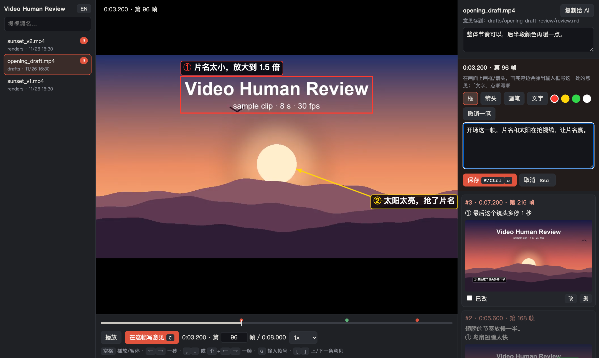

<div align="center">

# Video Human Review 视频人工审片

**暂停在任意一帧，直接在画面上圈画、写意见，审完一句话交给 AI 统一修改。**

[English](README.md) · 中文



</div>

和 AI 一起改视频时，审片通常是这样的：暂停、截图、裁剪、粘贴到对话框、打字说「0:03 那里片名太小……」，一条意见重复一遍。**Video Human Review** 把它变成：暂停 → 圈画 → 打字 → 下一条。审完时，它已经写好了一份 Markdown，每条意见都有时间码、准确帧号、画面位置和要改什么，外加一张带标注的截图。你只要复制一句话给 Claude、ChatGPT、Codex、Cursor 等能读文件的 AI，它就能照着清单逐条修改。

它是一个很小的本地网页工具：一个 Python 文件，不用装任何依赖，视频和意见都不会上传。


## 功能

- **精确到帧**：显示准确帧号（用 `ffprobe` 读视频真实帧率），可以一帧一帧走，也可以输入帧号直接跳过去。
- **在画面上圈画**：框、箭头、画笔、文字四种工具，四种颜色。每处标注旁边都能配一句话，并自动编号 ①②③，文字和图对得上。
- **AI 读得懂的导出**：`review.md` 里每条意见都有时间、帧号，标注的位置用文字写出来（`框（画面中上，x 24%–76%，y 10%–28%）`），再加上你配的话、带标注截图的路径和一张无标注的原画面。
- **审片流程**：意见在进度条上显示成小圆点，右侧列表最新的在最上面；可以修改、删除、勾「已改」，用 `[` `]` 在意见之间跳转，还有一栏不针对某一帧的整体意见。
- **收素材**：在好看的画面上框出想留下的一块（一样东西、一片天、一团火、一种构图），存成截图和整帧原图，交给 AI 拆成可复用的素材；AI 做好的复现和你框的并排显示，你点「通过 / 不通过」。
- **中文 / English**：界面随时切换，导出的 Markdown 也会改写成同一种语言。
- **本地、私密**：只读取你指定的目录，默认只监听 `127.0.0.1`，意见就写在每个视频旁边。

## 快速开始

需要 Python 3.7 以上和一个现代浏览器（Chrome、Edge、Safari、Firefox）。建议装上 [FFmpeg](https://ffmpeg.org/download.html)，这样帧号会按视频真实帧率算；没装的话按 30 fps 算。

```bash
git clone https://github.com/abysscat-yj/video-human-review-for-ai.git
cd video-human-review-for-ai
python3 video_human_review.py demo --open        # 先用自带的 8 秒示例视频试试
```

然后指向你自己的视频目录：

```bash
python3 video_human_review.py ~/Videos/my-project --open
```

这个目录下（包括子目录）所有 `.mp4 .mov .m4v .webm .mkv` 都会出现在左侧列表，最新的在最上面。

| 参数 | 默认值 | 说明 |
|---|---|---|
| `VIDEO_DIR` | 当前目录 | 要扫描视频的目录 |
| `--port` | `8765` | 也可以用环境变量 `VIDEO_REVIEW_PORT` |
| `--host` | `127.0.0.1` | 只有想让局域网里的人访问时才用 `0.0.0.0` |
| `--open` | 关 | 启动后自动打开浏览器 |

## 写一条意见

1. 暂停在要说的那一帧（或按 `G` 输入帧号），按 **`C`**。
2. 在画面上拖出一个**框**或**箭头**，旁边会弹出一个小输入框，写这里哪不对，按 `Enter`。**画笔**用来圈东西，**文字**点哪写哪。
3. 在右侧写这一帧的总体意见，按 **`⌘/Ctrl + Enter`** 保存。

截图按视频原分辨率保存，标注直接画在上面：


## 收素材

审片时看到做得好的地方，可以把它收下来，让 AI 拆成以后能复用的素材。

1. 暂停在那一帧，按 **`A`**（或点「收素材」）。
2. 在画面上拖一个框，框住想留下的部分。框外会暗下去，右侧能看到框出来的预览。
3. 选一个类别（物件、布景、天和光、特效、构图镜头、字、人物），起个名字，写一句喜欢它哪里，按 **`⌘/Ctrl + Enter`** 保存。

收下的素材在右侧「素材」一栏，进度条上是金色的小方块。文件写在审片目录的 `assets/` 里：

```
opening_draft_review/
└── assets/
    ├── assets.json        ← 清单，AI 读它、也往里回写
    ├── a001_crop.png      ← 框里那一块，原分辨率
    ├── a001_full.png      ← 整帧原图
    └── a001_ai.png        ← AI 做好后放的复现（可选）
```

`assets.json` 每条记着视频路径、秒、帧号、帧率、框（`[x0, y0, x1, y1]`，取 0–1 的比例）、类别、名字和备注，还有状态：

| 状态 | 谁改 | 意思 |
|---|---|---|
| `inbox` | 工具 | 刚收下，等 AI 处理 |
| `candidate` | AI | AI 做好了，在 `ai.render` 放了一张复现图，等你审 |
| `approved` | 你 | 在工具里点了「通过」 |
| `rejected` | 你 | 点了「不通过」并写了理由（存在 `verdict.text`），AI 照理由重做后再改回 `candidate` |

在「素材」一栏点 **复制给 AI**，会复制一句话，指向这份 `assets.json`。AI 怎么把素材做成代码或配方由你的项目决定，工具只管收和审。AI 回写之后，切回浏览器窗口，列表会自动刷新。只改名字、备注、类别时，AI 已做的结果会保留；重新画框，这一条就会退回 `inbox`。

## AI 拿到的是什么

点 **复制给 AI**，粘贴到对话框。这句话会指向 `review.md`，内容像这样：

```markdown
### #1 [ ] 0:03.200（第 96 帧）

开场这一帧，片名和太阳在抢视线，让片名赢。

画面标注（编号和截图上的一致）：
- ① 框（画面中上，x 24%–76%，y 10%–28%）：片名太小，放大到 1.5 倍
- ② 箭头（指向画面正中 x 56%，y 56%）：太阳太亮，抢了片名

截图：`drafts/opening_draft_review/001_0m03.200s.png`（带标注）
原画面（无标注）：`drafts/opening_draft_review/001_0m03.200s_clean.png`
```

标注的位置既写成了文字，也画在了截图上，就算框画得有点偏，AI 也能对上指的是什么。原画面让它看清箭头底下原本是什么。

文件都写在视频旁边：

```
drafts/
├── opening_draft.mp4
└── opening_draft_review/
    ├── review.md              ← 交给 AI 的就是它
    ├── comments.json          ← 工具自己的数据
    ├── 001_0m03.200s.png      ← 带标注的截图
    └── 001_0m03.200s_clean.png
```

改完一条就在工具里勾「已改」，`review.md` 里的勾选框会跟着变。`review.md` 每次都会根据 `comments.json` 重新生成，所以要改意见请在工具里改，不要直接改这个 Markdown。

## 快捷键

| 按键 | 作用 |
|---|---|
| `空格` | 播放 / 暂停 |
| `←` `→` | 后退 / 快进 1 秒 |
| `,` `.` 或 `Shift` + `←` `→` | 后退 / 前进 1 帧 |
| `G` | 输入帧号跳转 |
| `C` 或 `Enter` | 在这一帧写意见 |
| `A` | 在这一帧收素材（框出一块）|
| `[` `]` | 上一条 / 下一条意见 |
| `⌘/Ctrl + Enter` | 保存意见 |
| `Esc` | 取消（或跳过正在写的标注文字） |
| `⌘/Ctrl + Z` | 撤销上一笔标注（写意见时） |

也可以直接链接到某个时间点：`http://localhost:8765/#v=drafts/opening_draft.mp4&t=3.2`，或某条意见：`#v=drafts/opening_draft.mp4&note=1`。

## 常见问题

**已经在运行时再启动一次会怎样？** 它会找到正在运行的那一个，关掉它，在同一个端口重新启动，并打开浏览器，所以桌面快捷方式可以直接再点一次。如果端口被别的程序占了，它会换到下一个空闲端口，并打印新地址。

**会上传我的视频吗？** 不会。它是一个本地服务，只读取你指定的目录，只在视频旁边写 `*_review` 文件夹。

**帧号准吗？** 帧号 = `floor(时间 × 帧率)`，帧率来自 `ffprobe`；截图取的就是播放器当前显示的那一帧。没装 FFmpeg 时按 30 fps 算。

**支持哪些视频格式？** 浏览器能播的都行。H.264 的 MP4 到处都能用；HEVC、ProRes 要看浏览器和系统。

**团队能一起用吗？** 在可信的局域网里用 `--host 0.0.0.0` 启动，把地址发给同事即可。工具没有账号和权限，不要暴露到公网。

## 许可证

[MIT](LICENSE)
